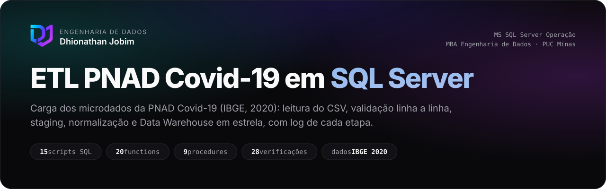
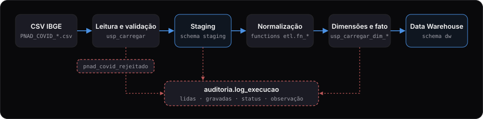
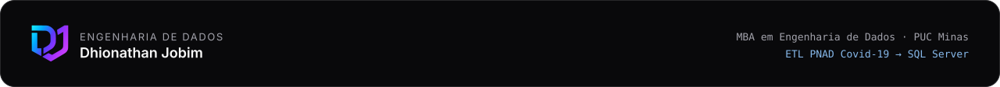

<p align="center">
  
</p>

Atividade prática da disciplina **MS SQL Server Operação** (MBA em Engenharia de Dados, PUC Minas).

Processo de carga dos microdados da **PNAD Covid-19** (IBGE, maio a novembro de 2020) com extração do CSV, validação linha a linha, staging, normalização e um Data Warehouse em modelo estrela. Cada etapa grava log com data/hora, linhas lidas, linhas gravadas, status e observação.

A documentação completa, com diagrama, modelo e roteiro de evidências, está em [`docs/index.html`](docs/index.html) (abra no navegador).

## Passo a passo para rodar (professor, comece aqui)

O jeito mais simples de avaliar é pelo notebook **[`pnad_covid_etl.ipynb`](pnad_covid_etl.ipynb)**, na raiz do projeto. Ele cria o banco, as tabelas, as functions e as procedures, roda o teste automatizado e mostra cada resultado com a explicação ao lado.

### 1. Instale (uma vez)

| Programa | Observação |
|----------|------------|
| [Docker Desktop](https://www.docker.com/products/docker-desktop/) | precisa estar **aberto** (ícone da baleia "running") antes dos comandos abaixo |
| [Python 3.10 ou mais novo](https://www.python.org/downloads/) | no instalador do Windows, marque *Add Python to PATH* |
| [VS Code](https://code.visualstudio.com/) | com as extensões **Python** e **Jupyter** da Microsoft |

### 2. Suba o SQL Server e crie o ambiente do notebook

Abra um terminal **na pasta do projeto** (no VS Code: *Terminal → New Terminal*).

**Windows (PowerShell):**

```powershell
Copy-Item .env.example .env
docker compose up -d
.\scripts\criar_venv.ps1
```

Se o PowerShell bloquear o script, rode antes `Set-ExecutionPolicy -Scope CurrentUser RemoteSigned` e tente de novo.

**Linux, macOS ou Git Bash:**

```bash
cp .env.example .env
docker compose up -d
./scripts/criar_venv.sh
```

`docker compose up -d` baixa a imagem do SQL Server na primeira vez (~1,5 GB). Depois dele, espere uns 30 segundos até `docker compose ps` mostrar `(healthy)`. O `criar_venv` cria a pasta `.venv`, instala as bibliotecas e registra o kernel **PNAD Covid (venv)**.

### 3. Reinicie o VS Code

**Feche o VS Code e abra de novo** (ou `Ctrl+Shift+P` → *Developer: Reload Window*). Sem isso o VS Code não enxerga o kernel que acabou de ser criado.

### 4. Rode o notebook

1. Abra `pnad_covid_etl.ipynb`.
2. Clique em **Select Kernel** (canto superior direito) e escolha **PNAD Covid (venv)**. Se ele não aparecer em *Jupyter Kernel*, procure o `.venv` do projeto em *Python Environments*.
3. Clique em **Run All**. O notebook todo roda em menos de um minuto com o CSV de teste, e a parte 12 deve terminar com **28 de 28** verificações conferindo.

### 5. (Opcional) Dados reais do IBGE

Na parte 13 do notebook, troque `CARREGAR_DADOS_REAIS = False` para `True` e rode a célula. Ela baixa o mês escolhido em `MESES` (~10 MB por mês) e o carrega no banco em cerca de 1 minuto por mês. Depois rode a parte 14 para ver os gráficos com os dados reais.

### Problemas comuns

| Mensagem | O que fazer |
|----------|-------------|
| `open //./pipe/dockerDesktopLinuxEngine: The system cannot find the file specified` | o Docker Desktop não está aberto; abra, espere ficar "running" e rode `docker compose up -d` de novo |
| `É preciso Python 3.10 ou mais novo.` | instale o Python 3.10+ e abra um terminal novo |
| Kernel **PNAD Covid (venv)** não aparece | feche e abra o VS Code (passo 3) |
| `Não consegui conectar` na parte 1 | o container ainda está subindo; confira `docker compose ps` e rode a célula de novo |

Sem o notebook, os mesmos passos rodam só por scripts; veja [Como executar](#como-executar).

## Arquitetura

<p align="center">
  
</p>

Tudo roda no SQL Server. O staging que o enunciado desenha no Oracle ficou no schema `staging` do mesmo banco.

## Estrutura

```
pnad-covid-etl/
├── pnad_covid_etl.ipynb      notebook explicativo (ponto de partida)
├── docker-compose.yml        SQL Server 2022 Developer
├── .env.example              senha do sa e porta
├── dados/                    CSVs do IBGE (fora do git)
├── scripts/                  baixar, instalar, executar e testar (.sh e .ps1)
├── sql/
│   ├── 00_setup/             banco e schemas
│   ├── 01_auditoria/         tabela e procedures de log
│   ├── 02_functions/         normalização textual e mapeamentos
│   ├── 03_staging/           tabelas de staging e etl.usp_carregar
│   ├── 04_dw/                dimensões e fato
│   ├── 05_procedures_dw/     cargas das dimensões e da fato
│   ├── 06_orquestracao/      pipeline completo e limpeza
│   └── 07_consultas/         consultas para evidências e análises
├── notebooks/                módulos de apoio do notebook e requirements
├── tests/                    CSV de teste, gerador e verificações
└── docs/                     documentação, roteiro de prints e imagens do README
```

| Schema      | Papel |
|-------------|-------|
| `staging`   | Dados como vieram do CSV, já tipados, mais as linhas rejeitadas |
| `dw`        | Dimensões e fato |
| `etl`       | Functions e procedures do processo (faz o papel de PACKAGE, que o SQL Server não tem) |
| `auditoria` | Log de execução |

## Como executar

Pré-requisitos: Docker (Docker Desktop no Windows) e Git.

### Windows (PowerShell)

```powershell
git clone <url-do-repositorio> pnad-covid-etl
cd pnad-covid-etl
Copy-Item .env.example .env          # troque a senha se quiser
docker compose up -d                 # sobe o SQL Server

.\scripts\instalar.ps1               # cria banco, tabelas, functions e procedures
.\scripts\testar.ps1                 # carga de teste com 28 verificações
.\scripts\baixar_dados.ps1           # baixa os 7 meses do IBGE (~80 MB zipado)
.\scripts\executar_pipeline.ps1      # CSV -> staging -> dimensões -> fato
```

Se o PowerShell bloquear os scripts: `Set-ExecutionPolicy -Scope CurrentUser RemoteSigned`.

### Linux, macOS ou Git Bash

```bash
cp .env.example .env
docker compose up -d
chmod +x scripts/*.sh

./scripts/instalar.sh
./scripts/testar.sh
./scripts/baixar_dados.sh            # ou: ./scripts/baixar_dados.sh 05   (só maio)
./scripts/executar_pipeline.sh
```

### Pelo SSMS ou Azure Data Studio

Servidor `localhost,1433`, usuário `sa`, senha do `.env`, com "Trust server certificate" marcado.

```sql
EXEC etl.usp_carregar @caminho_arquivo = N'/var/opt/mssql/dados/PNAD_COVID_052020.csv';
EXEC etl.usp_executar_pipeline;

SELECT * FROM auditoria.log_execucao ORDER BY id_log DESC;
```

Com SQL Server instalado direto no Windows (sem Docker), rode os arquivos de `sql/` na ordem numérica e passe o caminho do CSV no seu disco, por exemplo `N'C:\pnad\dados\PNAD_COVID_052020.csv'`. O serviço do SQL Server precisa ter permissão de leitura nessa pasta.

## Notebook explicativo

`pnad_covid_etl.ipynb` (na raiz) percorre o projeto em 15 partes, na ordem em que ele foi construído. Cada parte explica a decisão e executa o SQL do repositório contra o container, com as saídas no visual da identidade (tabelas, status do log, diagrama e gráficos).

Precisa de Python 3.10 ou mais novo. Com o container de pé:

```bash
./scripts/criar_venv.sh                     # Windows: .\scripts\criar_venv.ps1
source .venv/bin/activate                   # Windows: .\.venv\Scripts\Activate.ps1
jupyter lab pnad_covid_etl.ipynb
```

No VS Code, depois do `criar_venv`, feche e abra o VS Code, abra o `.ipynb` e escolha o kernel **PNAD Covid (venv)** (detalhes no [passo a passo](#passo-a-passo-para-rodar-professor-comece-aqui)). O notebook instala os objetos sozinho (não precisa rodar `instalar` antes), roda o teste com o CSV pequeno e deixa a carga dos dados reais do IBGE atrás de uma variável (`CARREGAR_DADOS_REAIS`).

| Pasta | Conteúdo |
|-------|----------|
| `notebooks/apoio/banco.py` | conexão (pymssql, sem precisar de driver ODBC) e execução dos `.sql` separando os `GO` |
| `notebooks/apoio/identidade.py` | cores, fonte, logo e gráficos com os tokens de `@lifehub/ui` |
| `docs/gerar_imagens.py` | gera as imagens deste README (`docs/img/*.svg`) a partir de `identidade.py` |

## O que cada rotina faz

### Procedures

| Procedure | Responsabilidade |
|-----------|------------------|
| `etl.usp_carregar` | Lê o CSV (BULK INSERT), acha as colunas pelo nome do cabeçalho, valida, grava as válidas em `staging.pnad_covid_pessoa` e as inválidas em `staging.pnad_covid_rejeitado`. Recarregar um mês substitui a versão anterior |
| `etl.usp_carregar_dim_tempo` | Ano/mês únicos da staging, com o nome do mês, sem duplicar |
| `etl.usp_carregar_dim_municipio` | Traduz o código da capital, normaliza o nome e insere só os novos |
| `etl.usp_carregar_dim_pessoa` | Faixa etária, sexo M/F e descrições por function; insere só perfis novos |
| `etl.usp_carregar_fato` | Resolve as chaves, agrega métricas, deixa fora (e registra) linhas sem chave |
| `etl.usp_executar_pipeline` | Executa as etapas na ordem e registra onde parou, se parar |
| `etl.usp_limpar_carga` | Esvazia staging, dimensões e fato (o log fica) |
| `auditoria.usp_log_iniciar` / `usp_log_finalizar` | Abrem e fecham a linha de log fora da transação |

### Functions

| Grupo | Functions |
|-------|-----------|
| Normalização textual | `fn_remover_espacos_extras`, `fn_remover_acentos`, `fn_capitular`, `fn_normalizar_texto` |
| Território | `fn_nome_uf`, `fn_sigla_uf`, `fn_nome_municipio`, `fn_normalizar_nome_municipio`, `fn_municipio_dw` |
| Pessoa | `fn_descricao_sexo`, `fn_sigla_sexo`, `fn_cor_raca`, `fn_escolaridade`, `fn_faixa_etaria`, `fn_faixa_rendimento` |
| Saúde | `fn_atendimento_sus`, `fn_internado`, `fn_sintoma`, `fn_teve_sintoma` |
| Tempo | `fn_nome_mes` |

### Log

`auditoria.log_execucao` recebe uma linha por execução de procedure:

| Status | Quando |
|--------|--------|
| `SUCESSO` | todas as linhas lidas foram gravadas |
| `SUCESSO PARCIAL` | parte das linhas foi rejeitada (motivos em `staging.pnad_covid_rejeitado`) |
| `ERRO` | nada foi gravado ou a execução falhou (mensagem do SQL Server na observação) |

### Validações da carga

Uma linha vai para `staging.pnad_covid_rejeitado` quando: não dá para separar os campos; ano ou mês faltam, ou o mês está fora de 1 a 12; a UF não existe; a idade falta ou está fora de 0 a 130; o sexo não é 1 ou 2; a capital informada não é a da UF; um campo de código traz texto.

## De-para das colunas

| Staging | CSV IBGE | Conteúdo |
|---------|----------|----------|
| `NU_ANO` | `Ano` | Ano de referência |
| `NU_MES` | `V1013` | Mês da pesquisa |
| `UF` | `UF` | Unidade da Federação |
| `CO_MUNICIPIO` | `CAPITAL` | Código da UF quando mora na capital; vazio fora dela |
| `COR_RACA` | `A004` | Cor ou raça |
| `SEXO` | `A003` | Sexo |
| `IDADE` | `A002` | Idade |
| `ESCOLARIDADE` | `A005` | Escolaridade |
| `FAIXA_RENDIMENTO` | `C01011` | Faixa do rendimento em dinheiro |
| `ATENDIMENTO_SUS` | `B0042` | Buscou pronto socorro do SUS/UPA |
| `INTERNADO` | `B005` | Ficou internado |
| `SINTOMA_*` | `B0011` a `B00112` | 12 sintomas, na ordem do enunciado |

O de-para mora na tabela `staging.mapa_coluna_csv`. Se o IBGE mudar um nome de coluna, basta atualizar a tabela.

## Decisões

- **Staging no SQL Server.** O diagrama do enunciado põe o staging no Oracle; a disciplina e a descrição do projeto pedem SQL Server, então o staging virou um schema do mesmo banco.
- **dim_pessoa guarda perfis.** A PNAD não identifica a pessoa. A dimensão tem uma linha por combinação de cor/raça, sexo, faixa etária, escolaridade e faixa de rendimento; a fato soma quantas pessoas há em cada uma.
- **Município vem de `CAPITAL`.** O microdado só identifica a capital. Quem mora no interior entra como `Demais Municipios` da UF.
- **Colunas acrescentadas ao enunciado:** `dw.dim_tempo.nu_mes` (ordenar e achar a chave), `dw.fato_pnad_covid.qt_pessoas` (base para percentuais) e `staging.pnad_covid_pessoa.ID_LOG` (liga a linha à carga que a gravou).
- **Sem peso amostral.** As métricas contam entrevistados. Para estimar a população seria preciso usar o peso `V1032`.

## Testes

`tests/gerar_teste.py` gera `tests/dados/PNAD_COVID_TESTE.csv` (cabeçalho entre aspas, colunas extras, CRLF, 12 linhas válidas e 7 inválidas, uma por regra) e `tests/sql/validar_carga_teste.sql` (28 verificações de log, staging, rejeitadas, dimensões e fato). `scripts/testar` limpa as tabelas, carrega o CSV de teste, roda o pipeline e as verificações; qualquer diferença interrompe com erro.

## Evidências

O roteiro dos prints está em [`docs/evidencias/README.md`](docs/evidencias/README.md), e as consultas em `sql/07_consultas/01_evidencias.sql`.

## Fonte

Microdados PNAD Covid-19, IBGE: https://ftp.ibge.gov.br/Trabalho_e_Rendimento/Pesquisa_Nacional_por_Amostra_de_Domicilios_PNAD_COVID19/Microdados/Dados/

<br>

<p align="center">
  
</p>
